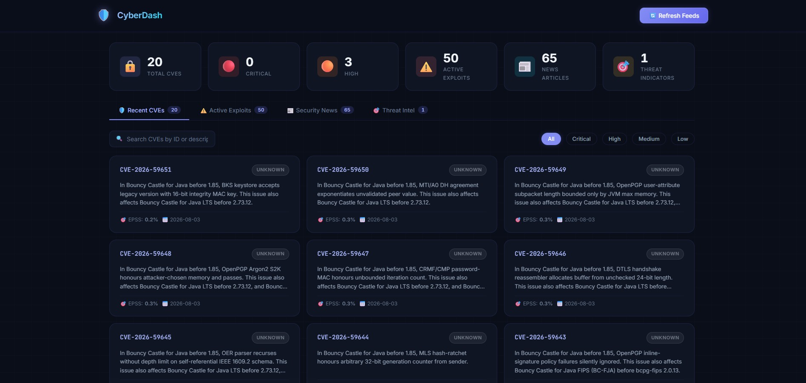

# CyberDash — Cybersecurity Dashboard

FastAPI, SQLite, and vanilla HTML/CSS/JavaScript for vulnerability feeds,
threat intelligence, IOC investigations, Sigma/YARA rule management, and alerts.



## Local development

Requires Python 3.11+.

```bash
python3 -m venv .venv
source .venv/bin/activate
pip install -r requirements.txt

# Generate a development signing key. Keep the same secret across restarts
# if sessions should survive. Production must use a managed secret store.
export JWT_SECRET_KEY="$(python -c 'import secrets; print(secrets.token_hex(32))')"
python -m app.main
```

Open <http://127.0.0.1:8000> and complete the administrator setup wizard.
There is **no default administrator password**. Provision the initial account
before exposing a new instance publicly. The primary account is protected by
database identity, not its username.

Use **Refresh Feeds** after logging in as an analyst or administrator. Live
feeds need outbound Internet access. NVD requests are paginated and paced to
respect its public limits; an initial refresh can take longer than one request.
The initial NVD import covers the last seven days of modifications; subsequent
runs use a persisted watermark. CISA KEV imports the complete catalog.

### Configuration

| Variable | Purpose |
| --- | --- |
| `JWT_SECRET_KEY` | Required unique random secret, at least 32 bytes. Missing/known insecure values prevent startup. |
| `DATABASE_PATH` | SQLite file; defaults to `cyber_dashboard.db` in the project root. The app never silently falls back to another database. |
| `ENV` | Set to `production` for HTTPS-only session cookies behind a trusted TLS proxy. |
| `NVD_API_KEY` | Optional NVD key for higher request throughput. |
| `URLHAUS_API_KEY` | Optional Abuse.ch feed credential. |
| `URLHAUS_RECENT_URL` | Optional trusted operator override of the URLhaus source. |

For a persisted local environment, copy `.env.example`, fill in the secret,
then run `.venv/bin/uvicorn app.main:app --env-file .env --reload`.
Never commit `.env` or copy a development secret into production.

## Access and API

- Guests can view the public intelligence dashboard, actor directory, and rule catalog.
- Authenticated viewers can read APIs and shared investigation history.
- Analysts/admins can investigate IOCs, author rules, and refresh feeds.
- Admins manage accounts, tokens, feeds, schedules, and alert destinations.
- Deletion, role changes, and password changes invalidate existing sessions;
  logout revokes the current session across workers.
- Machine tokens support `X-API-Key: cd_live_...` or `Authorization: Bearer cd_live_...`.
  Only hashes are stored. Per-token fixed-minute limits are enforced in SQLite;
  excess requests return **429** with `Retry-After`.

Interactive documentation: `/docs`, `/redoc`, `/openapi.json`.
The Settings API explorer derives routes from OpenAPI rather than an independent
hard-coded catalog. Investigation uses **GET `/api/investigate?ioc=...`**;
rules use **`/api/detection-rules`**.

Public operational probes: **`/api/health`** (liveness) and **`/api/ready`**
(database readiness, including before administrator setup).

Unknown intelligence is reported as unknown—not fabricated CVSS scores or
VirusTotal detections. Curated CVE descriptions are explanatory only; live
ratings take precedence. IOC matching is exact and type-specific. External
pivot links are not evidence that those services were queried.

## Tests

```bash
.venv/bin/python -m scratch.run_tests
# Run just the review regressions:
.venv/bin/python -m scratch.test_review_regressions
# Optional: build the image, then check two-worker behavior and persistence:
docker build -t cyberdash:review-fixes .
.venv/bin/python -m scratch.container_smoke cyberdash:review-fixes
```

The runner executes each suite in its own process. Test fixtures replace any
inherited database path and signing secret before importing the application.
Older requests-style checks use an **in-process TestClient**, not a live server.
Unexpected outbound HTTP is blocked. Do not collect the independently bootstrapped
suites together in a single interpreter; use the runner above.

## Hosting and backups

The Docker image runs as a non-root user. Supply `JWT_SECRET_KEY` and mount a
durable volume at `/app/data`, owned/writable by UID/GID **10001**. For example:

```bash
docker build -t cyberdash .
docker run --rm -p 8000:8000 --env-file .env -v cyberdash-data:/app/data cyberdash
```

Azure Bicep/pipeline configuration is **development-only F1 (Free)**. Both Bicep
templates reject paid SKUs; there is no automatic paid-tier fallback. Always On
and persistent App Service storage are disabled. SQLite lives in
`/app/data/cyber_dashboard.db`: **accounts, rules, tokens, and audit history may
be lost when Azure replaces the container**. The app can sleep or stop under F1
quotas; scheduled refreshes are not guaranteed while it is idle.

Configure an Azure DevOps **secret variable** named `jwtSecretKey` before
deployment. `ENV=production` remains set solely to enforce secure HTTPS cookies;
it does not select a paid hosting tier. Existing `prod` resource/stage identifiers
are retained for compatibility, not as a production-readiness claim.
No deployment runs from feature branches.
Tests, quality gates, high/critical dependency/container findings, Semgrep
findings, DAST failures, and failed readiness probes block deployment. ZAP warnings
remain advisory. Environment approval policies are configured separately in Azure.

F1 requests remain subject to Azure subscription, regional, and workload support.
If Azure rejects F1 for the container workload, deployment must fail rather than
upgrade to a paid plan. This configuration does not provision paid storage,
databases, registries, or monitoring. CI minutes and third-party services still
depend on your existing free allowances; a code change does not remove charges
from any resources already running in Azure.

SQLite is intended for a single deployment instance. Validate filesystem locking
on the selected persistent storage; network filesystems can have SQLite locking
limitations. Use a server database before horizontal scaling. Persistence is
**not** a backup, and this repository does not provision an automated backup schedule.

Create a consistent backup (output must not already exist):

```bash
python -m scripts.backup_database --database /path/cyber_dashboard.db --output /backup/cyberdash-2026-11-01.db
```

Keep encrypted/off-host backups with retention appropriate to your organization.
To restore: stop **all** application workers, retain the current database and any
journal/WAL files as a separate recovery copy, restore the verified backup at
`DATABASE_PATH`, set ownership/permissions, then restart and check `/api/ready`.
Test restores in a separate environment before relying on them.

### Audit integrity and upgrades

New audit entries use canonical JSON SHA-256 chaining, including IP addresses,
and append under a database write lock. Existing v1 entries are preserved and
reported as legacy; their IP fields were never protected. This is **not** an
immutable ledger or a Merkle tree. Verification returns a checkpoint
(`id`, `integrity_hash`); save it outside the application database and supply
`checkpoint_id` and `checkpoint_hash` to `/api/audit-logs/verify` to detect tail
deletion or rewriting relative to that checkpoint.

**Before upgrading:** take a backup, configure the signing secret, and plan for
existing browser sessions to be invalidated. Migrations run at startup; this
change does not rewrite existing audit history or automatically clean up legacy
intelligence records. Rotate secrets and review data imported by older releases.

## Asset-aware prioritization

Feature 1 adds private inventory, software observations, explicit CVE assessments,
CSV preview/commit, exports, and an explainable priority queue. It is **disabled
by default**. Set `FEATURE_ASSET_PRIORITIZATION=true` and restart to enable it.
See [operation, permissions, scoring, and recovery](docs/asset-prioritization.md).
No scanning, paid infrastructure, or cloud deployment is introduced.

## Feature roadmap

Detailed plans for the five features are in
[the feature-plan roadmap](docs/feature-plans/README.md). Features 2–5 remain
proposals. Feature 1 is implemented behind its
default-off flag. Features are implemented one at a time after approval,
without changing the F1-only, zero-paid-infrastructure development constraint.
